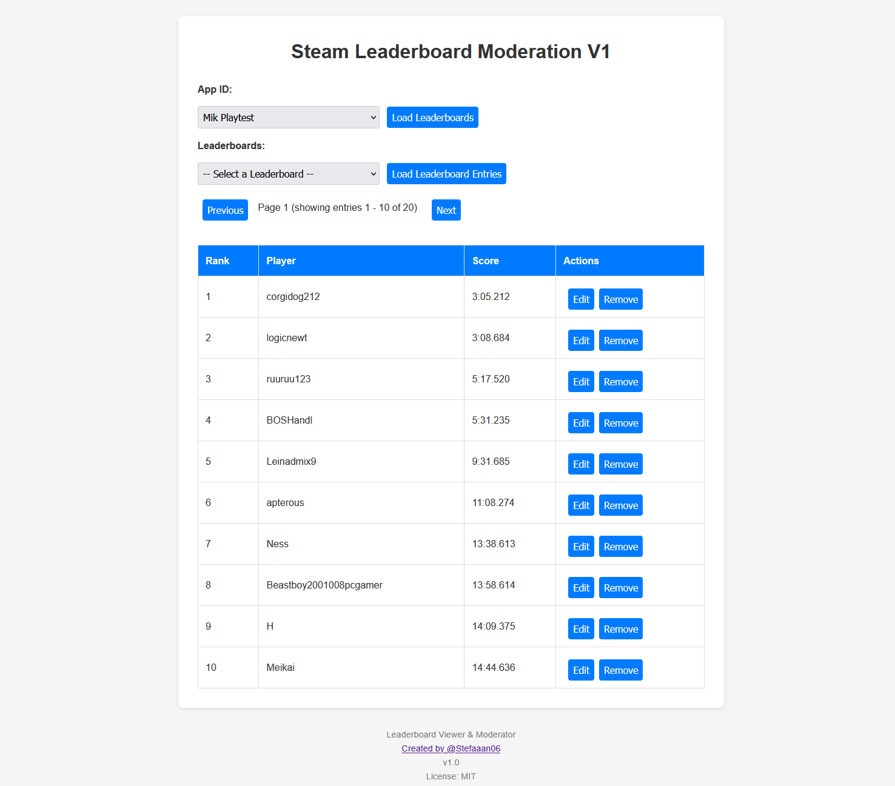

# Steam-Leaderboard-Moderation
```Version 1.2```

A simple web application written in Node.js interfacing with the Steam API, allowing for easy removal and editing of leaderboard entries since the Steamworks (UI) itself lacks this feature.



## Setup Guide

### Prerequisites

- Node.js (v14 or higher)
- npm (v6 or higher)
- Steamworks Partner account & API Key

### Installation

1. Clone the repository:
    ```sh
    git clone https://github.com/Stefaaan06/Steam-Leaderboard-Moderation.git
    cd Steam-Leaderboard-Moderation
    ```

2. Install dependencies:
    ```sh
    npm install
    ```

3. Create a `.env` file in the root directory and add your Steam Publisher API Key:
    ```env
    STEAM_PUBLISHER_API_KEY=your_api_key_here
    ```
   How to get your API key: https://partner.steamgames.com/doc/webapi_overview/auth (dont confuse with User Keys)


4. (optional) Update index.html with your own appID -
   The appID in index.html is currently configured for my own game. Replace it with your own appID. You can also add multiple options
    ```html
    <select id="appidSelect">
        <option value="YOUR APP ID">YOUR APP NAME</option>
    </select>
    ```
   You can also input an appID when selecting "Custom" in the dropdown.

5. Start the server:
    ```sh
    npm start
    ```
      

6. The website will run on `http://localhost:3000` if not configured differently.


## Usage Guide

### Viewing Leaderboards

1. Select an App ID from the dropdown or input your own.
2. Click "Load Leaderboards" to fetch the leaderboards for the selected App ID.
3. Select a leaderboard from the dropdown.
4. Click "Load Leaderboard Entries" to view the entries.

### Editing an Entry

1. Click the "Edit" button next to the entry you want to edit.
2. Enter the new score in the prompt.
3. Confirm the update.

### Removing an Entry

1. Click the "Remove" button next to the entry you want to remove.
2. Confirm the removal.

### Note to Editing and Removing
- The Steam API may take some time to reflect changes made to leaderboard entries. The application stores changes in local storage (memoryStore.js) so the modifications are visible immediately. While the program does try to display issues with changes, changes MAY happen.

## Known Issues
1. When Removing / Editing entries the displayed entries on the website dont update properly.
2. No full support for Descending leaderboards yet
3. The website stashes your changes in local storage on purpose. This is because steam leaderboards may take some time to update.
4. Due to steam API limitations: you CANNOT edit an entry for a User that doesnt own the game anymore - only deleting will work.
5. When deleting / editing entries the pagination doesnt update properly. (deleting all entries on a page makes it empty)
6. Users are sometimes on 2 pages at once - (same problem as above)

## TODO: 
1. Batch Delete
2. User Management (view one users entires and manage them)
3. Leaderboard Creation & Management
3.1 Full Support for Descending and non time based leaderboards
4. Better UI/UX (Darkmode, toasts, loading indicators.. )
5. Better REST rotue names and structure (filenames are weird rn)
6. Dont have all the client js in one file


## Links

- [Steamworks Web API Keys](https://partner.steamgames.com/doc/webapi_overview)
- [Steam Leaderboards API](https://partner.steamgames.com/doc/webapi/ISteamLeaderboards)
- [Steam User API](https://partner.steamgames.com/doc/webapi/ISteamUser)

## License & Contribution

This project is licensed under the MIT License.
Any contribution is welcome and will be under the same license.
